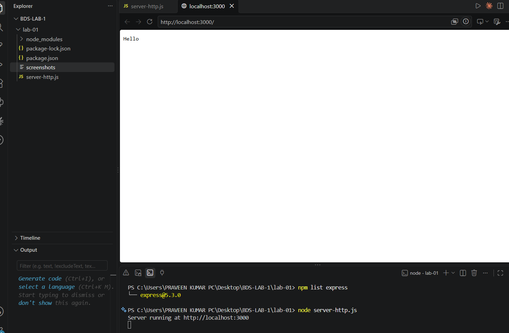
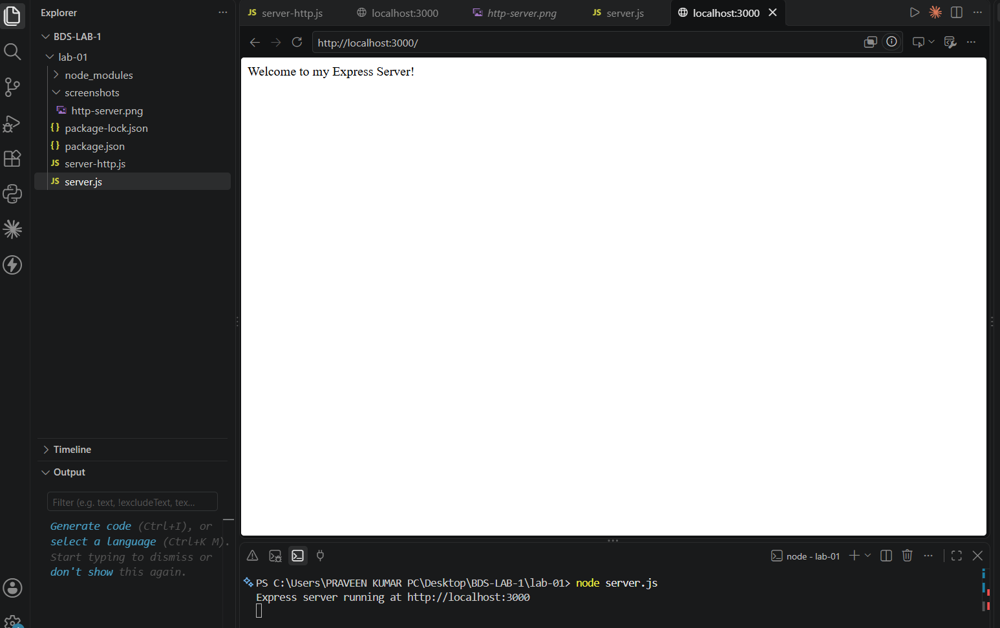
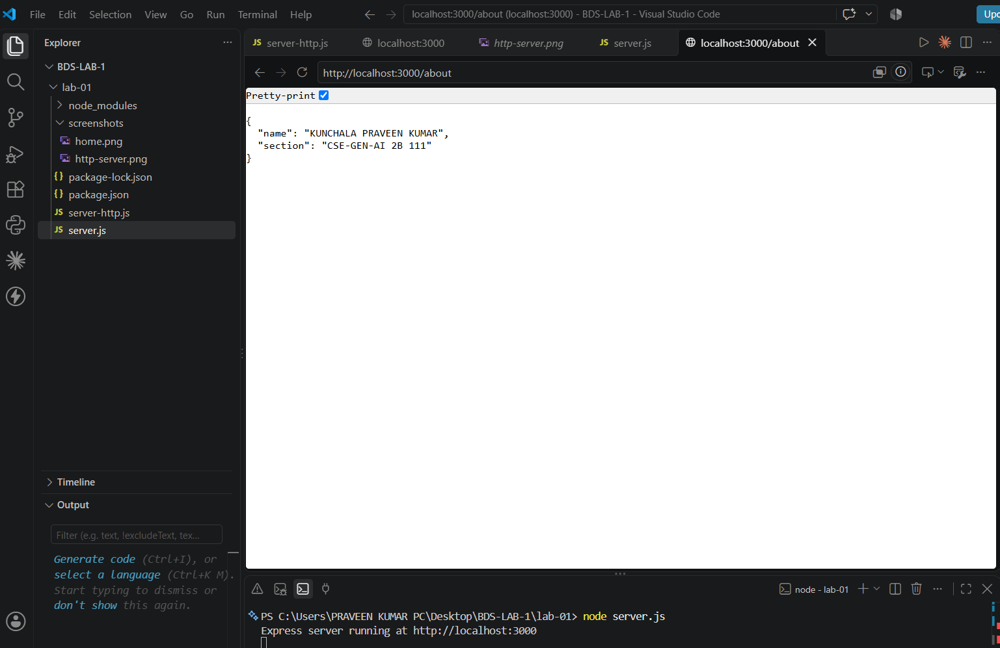
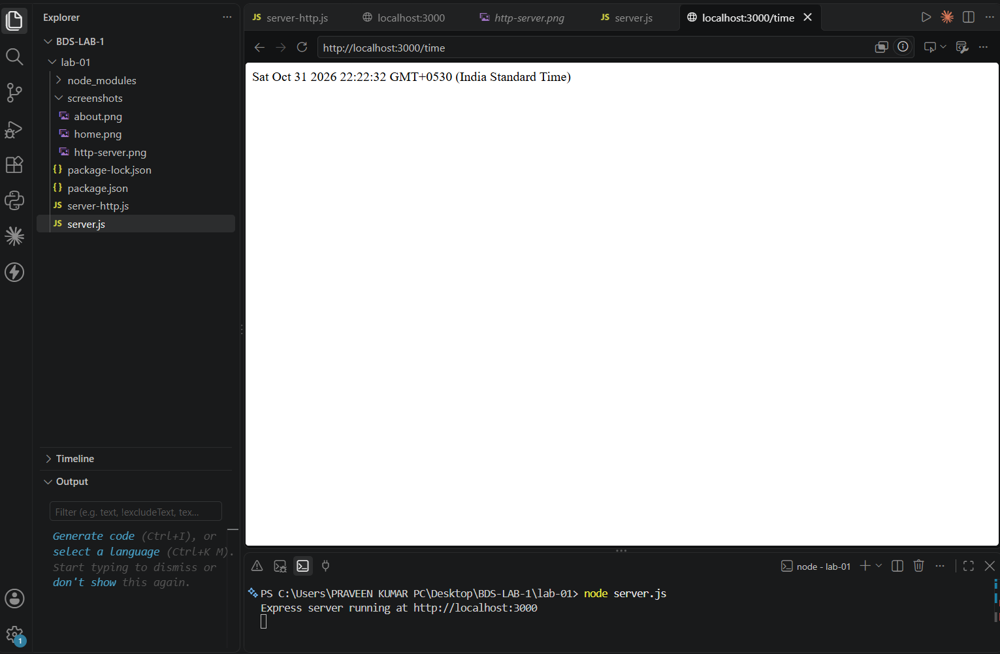
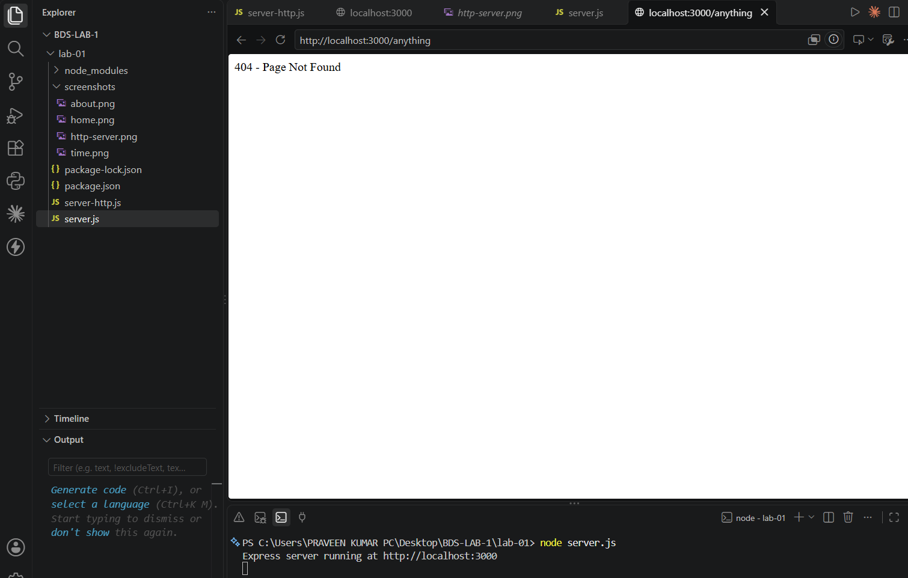

# Lab 1: Node.js and Express server

**Course:** Backend Development Fundamentals
**Lab Number:** 01

**Name:** Kunchala Praveen Kumar
**Registration Number:** 252U1R9081
**Section:** CSE-GEN-AI 2B 111

## Live Link

https://backend-lab-01-cgdb.onrender.com

## Objective

To set up a Node.js project and build a web server using the built-in HTTP module and Express.js. The server handles different GET requests and returns appropriate responses and HTTP status codes.

## Technologies Used

- Node.js
- Express.js
- JavaScript
- Visual Studio Code
- npm

## Project Structure

```text
lab-01/
├── node_modules/
├── screenshots/
│   ├── about.png
│   ├── home.png
│   ├── http-server.png
│   ├── not-found.png
│   └── time.png
├── .gitignore
├── package.json
├── package-lock.json
├── server-http.js
├── server.js
└── README.md
```

## Installation and Running Instructions

### 1. Clone the repository

```bash
git clone YOUR_GITHUB_REPOSITORY_URL
```

### 2. Navigate to the lab folder

```bash
cd lab-01
```

### 3. Install dependencies

```bash
npm install
```

### 4. Run the Node.js HTTP server

```bash
node server-http.js
```

Open `http://localhost:3000` in your browser.

### 5. Run the Express server

Stop the previous server using `Ctrl + C`, then execute:

```bash
node server.js
```

Open `http://localhost:3000` in your browser.

### Environment Variables

No environment variables are required for this lab.

## Endpoints

| Method | Path        | Description                             | Status Code |
| ------ | ----------- | --------------------------------------- | ----------- |
| GET    | `/`         | Displays the welcome message            | 200         |
| GET    | `/about`    | Returns name and section in JSON format | 200         |
| GET    | `/time`     | Returns the current date and time       | 200         |
| GET    | `/anything` | Returns a 404 message for unknown paths | 404         |


## Screenshots

### 1. Node.js HTTP Server


### 2. Home Route


### 3. About Route


### 4. Time Route


### 5. 404 Not Found Route



## Understanding package.json

- **name:** Name of the project.
- **version:** Current project version.
- **description:** Brief description of the project.
- **main:** Default package entry point.
- **scripts:** Contains executable npm commands.
- **keywords:** Keywords related to the project.
- **author:** Project author's name.
- **license:** Project license.
- **type:** Specifies the JavaScript module system.

## Viva Questions and Answers

**1. What is the difference between package.json and node_modules?**

package.json stores project information and dependency details, whereas node_modules contains the actual installed packages.

**2. What does app.listen() do?**

It starts the Express server and makes it listen for incoming requests on the specified port.

**3. What do request and response represent?**

Request (req) represents the incoming request from the client, and response (res) represents the response sent by the server.

## Problems Faced and Solutions

1. Initially, the server.js file was placed in the wrong directory. This was resolved by moving it into the lab-01 folder.
2. The server could not start because the previous server was still using port 3000. This was resolved by stopping the previous server before starting the Express server.
3. The About route initially displayed incorrect name information. This was corrected by updating the JSON response and restarting the server.

## Conclusion

Successfully created a Node.js HTTP server and an Express.js server. Implemented GET routes for the home page, about information and current date and time. Also implemented 404 handling for unknown routes and verified the responses using a browser.
