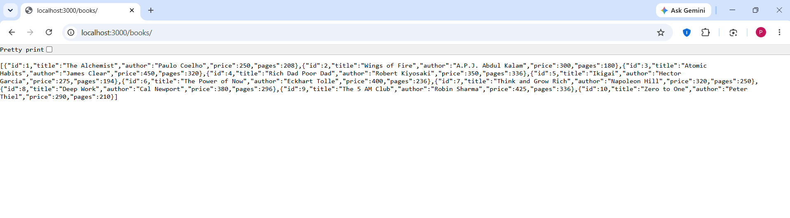
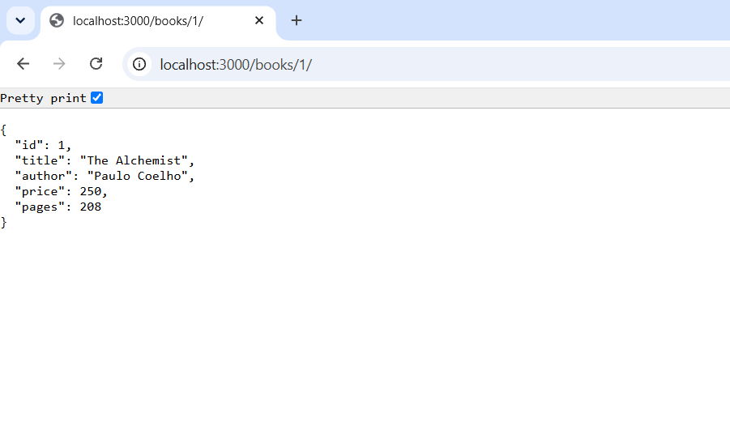
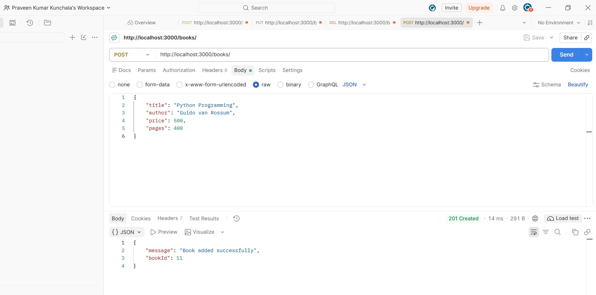
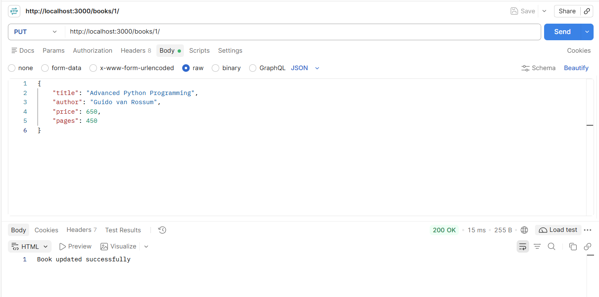
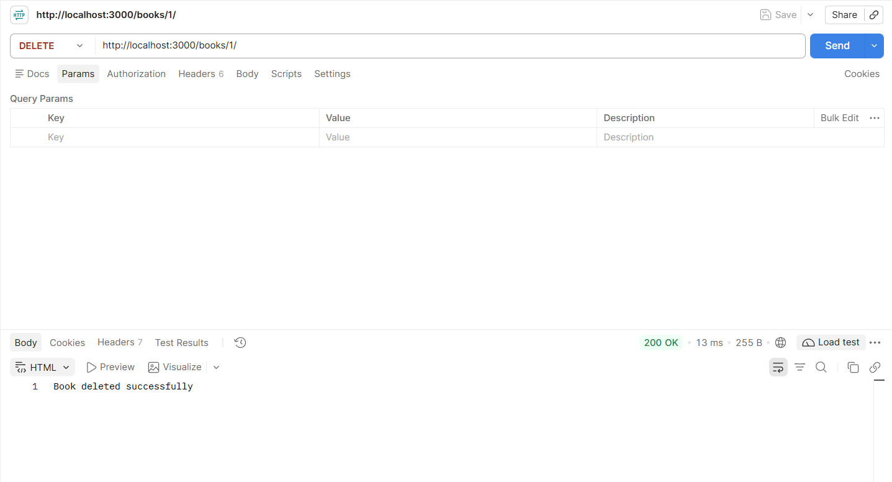
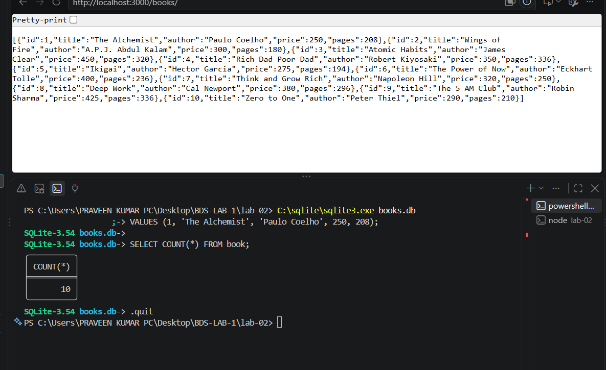

# Lab 02: SQLite Database and CRUD Routes

## Student Details

- **Name:** Kunchala Praveen Kumar
- **Registration Number:** 252U1R9081
- **Section:** CSE-GEN-AI 2B 111
- **Course:** Backend Development Fundamentals
- **Lab Number:** 02

## Objective

To connect an Express.js application with an SQLite database and implement CRUD (Create, Read, Update, Delete) operations through HTTP routes.

## Technologies Used

- Node.js
- Express.js
- SQLite
- sqlite3
- sqlite
- Nodemon
- Postman
- Visual Studio Code

## Project Structure

```text
lab-02/
├── screenshots/
│   ├── database-verification.png
│   ├── get-all-books.png
│   ├── get-book-by-id.png
│   ├── post-book.png
│   ├── put-book.png
│   └── delete-book.png
├── app.js
├── db.js
├── books.db
├── package.json
├── package-lock.json
└── README.md
```

## Installation

Install the required dependencies:

```bash
npm install
```

## Running the Application

Start the application in development mode using Nodemon:

```bash
npm run dev
```

To run normally:

```bash
npm start
```

The server runs at:

```text
http://localhost:3000
```

## Database Details

Database file: `books.db`

Table name: `book`

Table structure:

| Column | Data Type |
|---|---|
| id | INTEGER PRIMARY KEY |
| title | TEXT |
| author | TEXT |
| price | INTEGER |
| pages | INTEGER |

The database initially contains 10 book records.

## API Endpoints

### 1. GET All Books

- **Method:** GET
- **Endpoint:** `/books/`
- **Description:** Retrieves all books from the database.
- **Success Status:** 200 OK

### 2. GET Book by ID

- **Method:** GET
- **Endpoint:** `/books/:bookId/`
- **Description:** Retrieves a specific book using its ID.
- **Success Status:** 200 OK
- **Not Found:** 404 Not Found

### 3. Add a New Book

- **Method:** POST
- **Endpoint:** `/books/`
- **Description:** Inserts a new book into the database.
- **Success Status:** 201 Created

Example JSON:

```json
{
  "title": "Python Programming",
  "author": "Guido van Rossum",
  "price": 500,
  "pages": 400
}
```

### 4. Update a Book

- **Method:** PUT
- **Endpoint:** `/books/:bookId/`
- **Description:** Updates the details of an existing book.
- **Success Status:** 200 OK

### 5. Delete a Book

- **Method:** DELETE
- **Endpoint:** `/books/:bookId/`
- **Description:** Deletes a book using its ID.
- **Success Status:** 200 OK

## SQL Parameterization

SQL queries use `?` placeholders to safely pass user-provided values into database operations.

This helps prevent SQL injection attacks.

## Asynchronous Database Operations

The application uses `async/await` to handle database operations.

The server starts only after the SQLite database connection is successfully established.

## Screenshots

### 1. GET All Books



### 2. GET Book by ID



### 3. POST - Add a New Book



### 4. PUT - Update a Book



### 5. DELETE - Delete a Book



### 6. Database Verification



## Testing

All five CRUD endpoints were tested using Postman.

The database was also verified using the SQLite command-line interface.

## Deployment

This lab was tested locally using SQLite and Express.js. It has not been deployed to a public hosting service.

## Conclusion

Successfully connected an Express.js application to an SQLite database and implemented all five CRUD HTTP endpoints. Tested database operations using Postman and verified changes directly through SQLite.