# Lab 03 – Advanced REST API Development

## Student Details

- **Name:** Kunchala Praveen Kumar
- **Registration Number:** 252U1R9081
- **Section:** CSE-GEN-AI 2B 111
- **Course:** Backend Development Fundamentals

## Objective

To develop advanced RESTful API endpoints using Node.js, Express.js, and SQLite. The application supports searching, sorting, pagination, price filtering, and complete CRUD operations with proper request validation and HTTP status codes.

## Technologies Used

- Node.js
- Express.js
- SQLite
- SQLite3
- JavaScript
- Postman
- Visual Studio Code

## Project Structure

```text
lab-03/
│
├── screenshots/
│   ├── database-verification.png
│   ├── delete-book.png
│   ├── delete-verification.png
│   ├── get-all-books.png
│   ├── get-book-by-id.png
│   ├── invalid-query.png
│   ├── pagination.png
│   ├── post-book.png
│   ├── price-filter.png
│   ├── put-book.png
│   ├── search-books.png
│   └── sort-books.png
│
├── app.js
├── db.js
├── books.db
├── package.json
├── package-lock.json
└── README.md
```

## Database Structure

Database Name: `books.db`

Table Name: `book`

| Column | Data Type | Description |
|---|---|---|
| id | INTEGER | Primary Key |
| title | TEXT | Book title |
| author | TEXT | Author name |
| price | INTEGER | Book price |
| pages | INTEGER | Number of pages |

The database contains 10 initial book records.

## API Endpoints

Base URL: `http://localhost:3000`

### 1. GET – Retrieve All Books

**Endpoint:** `/books`

Retrieves all books from the database.

### 2. GET – Retrieve Book by ID

**Endpoint:** `/books/:bookId`

Retrieves a specific book using its ID.

### 3. POST – Add a New Book

**Endpoint:** `/books`

Adds a new book to the database using JSON request data.

### 4. PUT – Update a Book

**Endpoint:** `/books/:bookId`

Updates the details of an existing book.

### 5. DELETE – Delete a Book

**Endpoint:** `/books/:bookId`

Deletes a book using its ID.

## Advanced API Features

### Search

Uses the `search_q` query parameter to search books by title.

Example:

`GET /books?search_q=Atomic`

### Sorting

Supports sorting by allowed columns and ascending or descending order.

Example:

`GET /books?order_by=price&order=DESC`

### Pagination

Uses `limit` and `offset` parameters to retrieve records in smaller groups.

Example:

`GET /books?limit=3&offset=0`

### Price Filtering

Supports minimum and maximum price filtering.

Example:

`GET /books?min_price=250&max_price=350`

## Request Validation

The API validates:

- Allowed sorting columns.
- Sorting order (ASC or DESC).
- Positive integer limit.
- Non-negative integer offset.
- Numeric minimum and maximum prices.
- Minimum price must not exceed maximum price.
- Book existence before update or delete operations.

## Security and Database Handling

- Uses parameterized SQL queries to prevent SQL injection.
- Uses async/await for database operations.
- Uses Express JSON middleware to handle request bodies.
- Validates query parameters before executing database queries.

## Screenshots and Testing

### 1. GET All Books

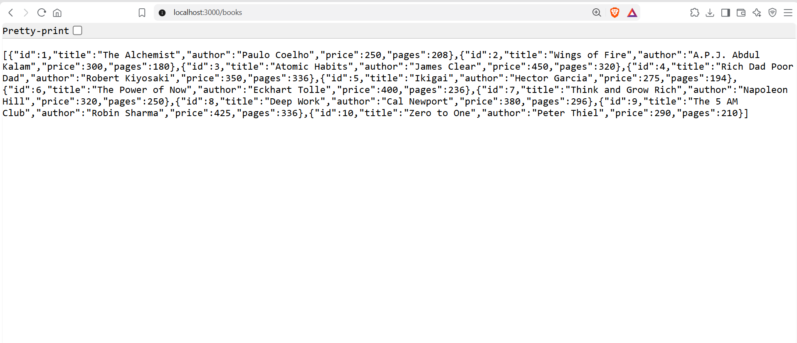

### 2. GET Book by ID

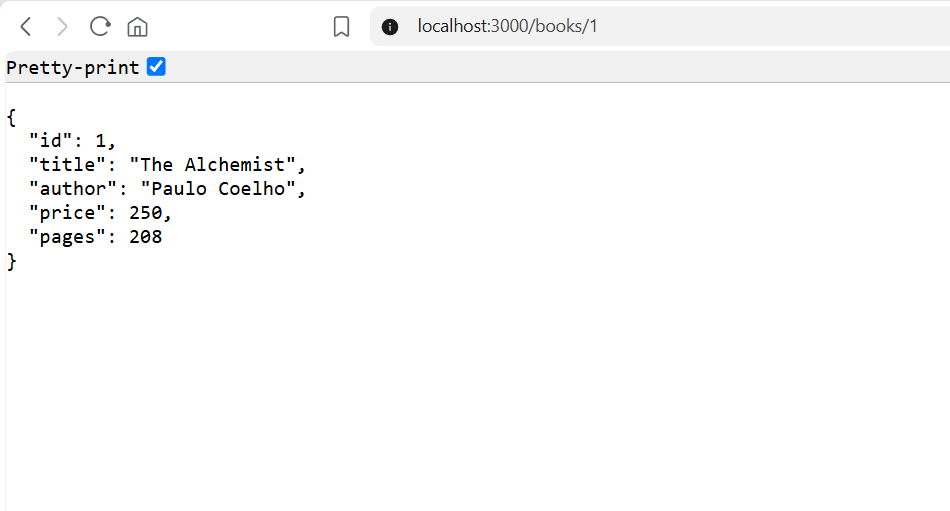

### 3. Search Books

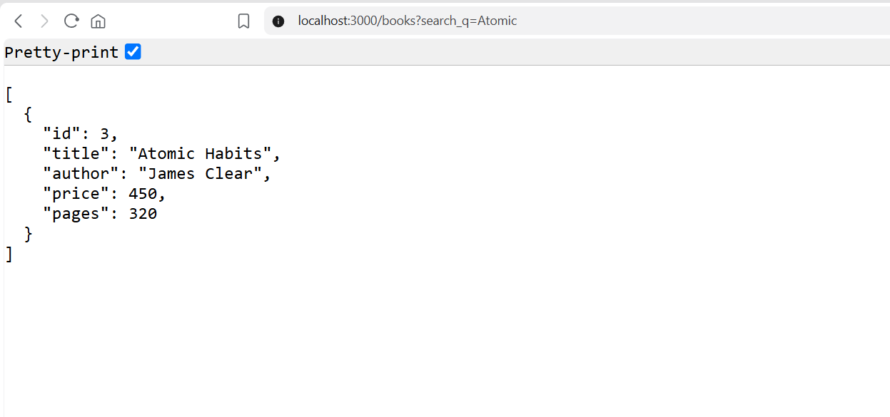

### 4. Sort Books

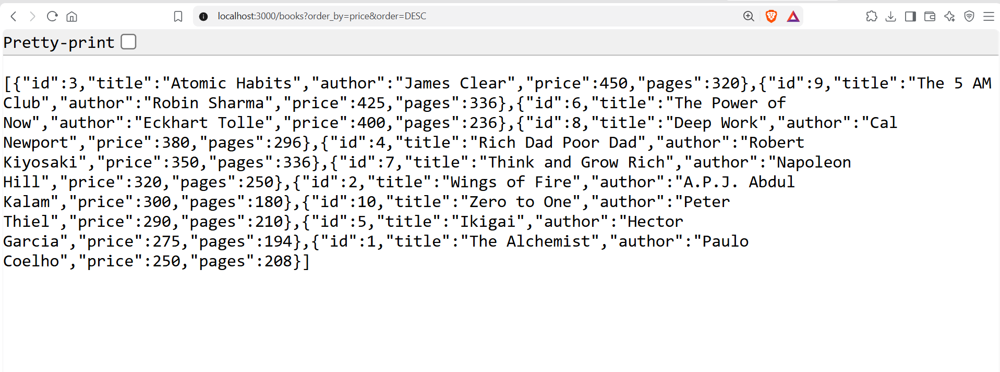

### 5. Pagination

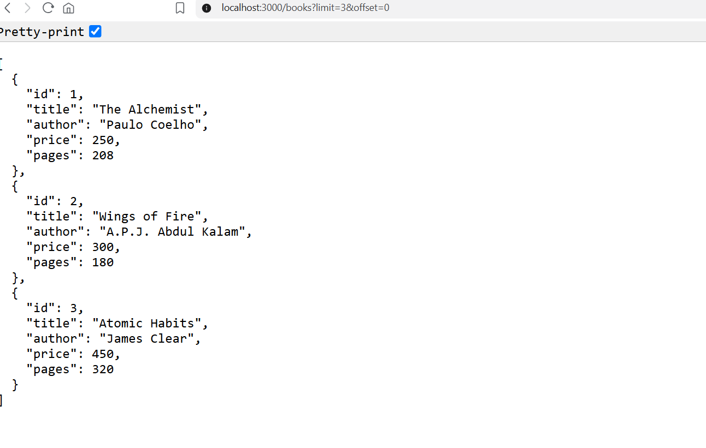

### 6. Price Filtering

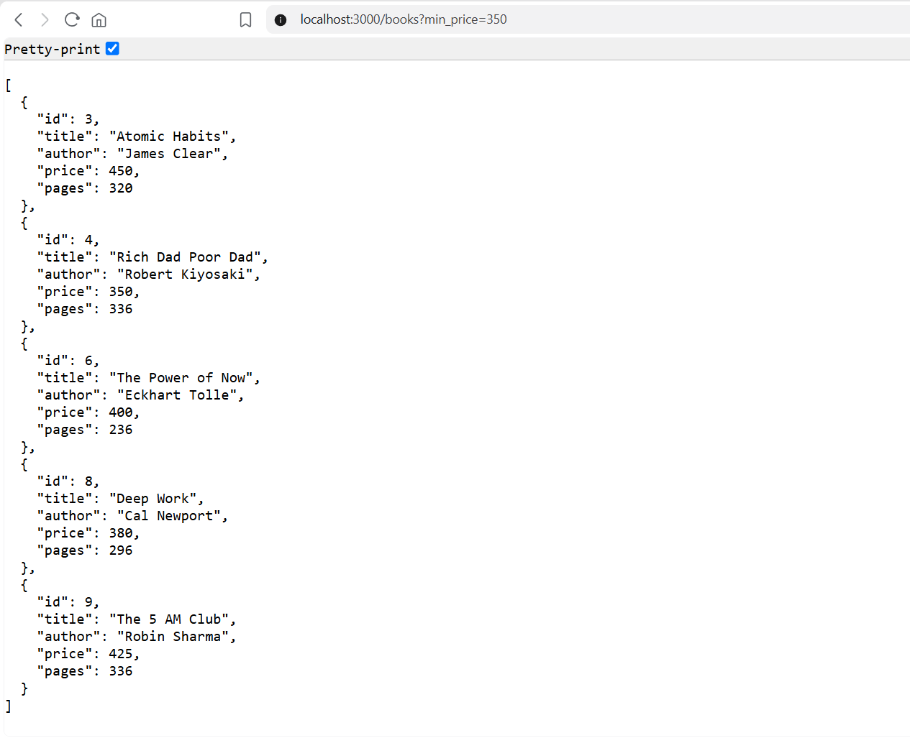

### 7. Invalid Query Validation

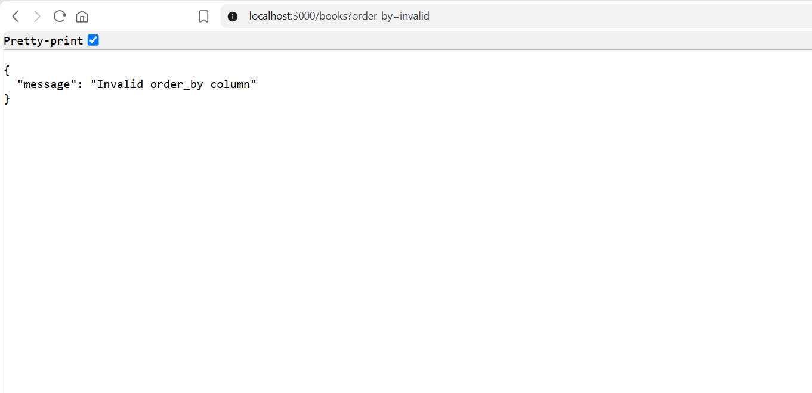

### 8. POST Book

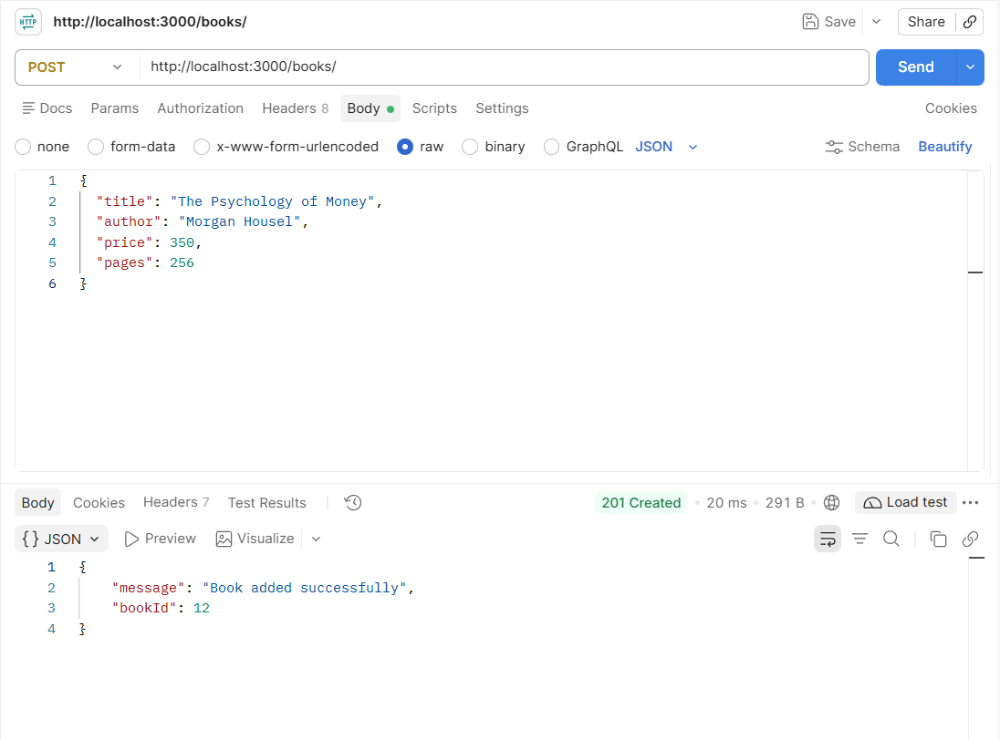

### 9. PUT Book

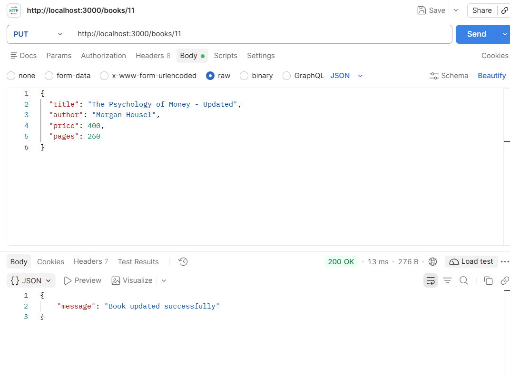

### 10. DELETE Book

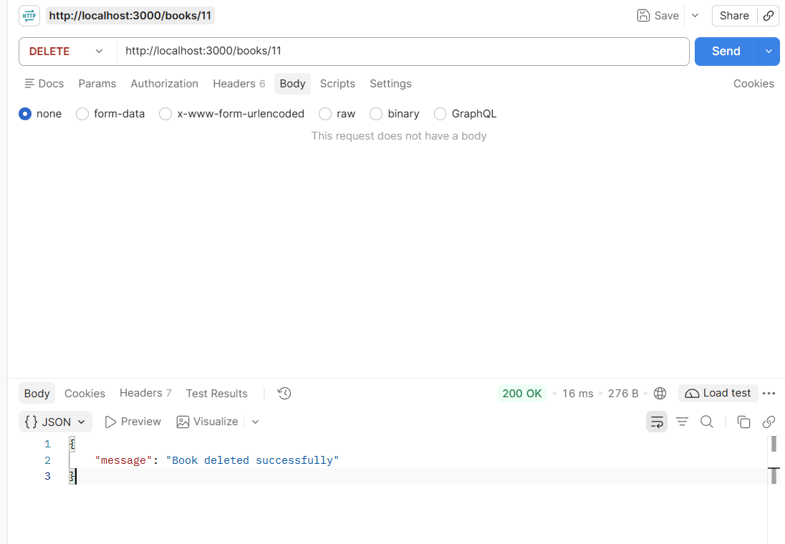

### 11. DELETE Verification

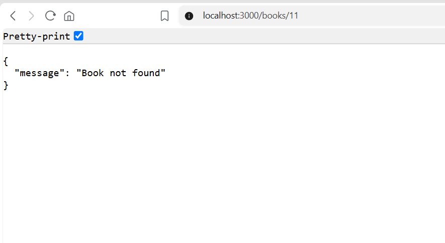

### 12. Database Verification

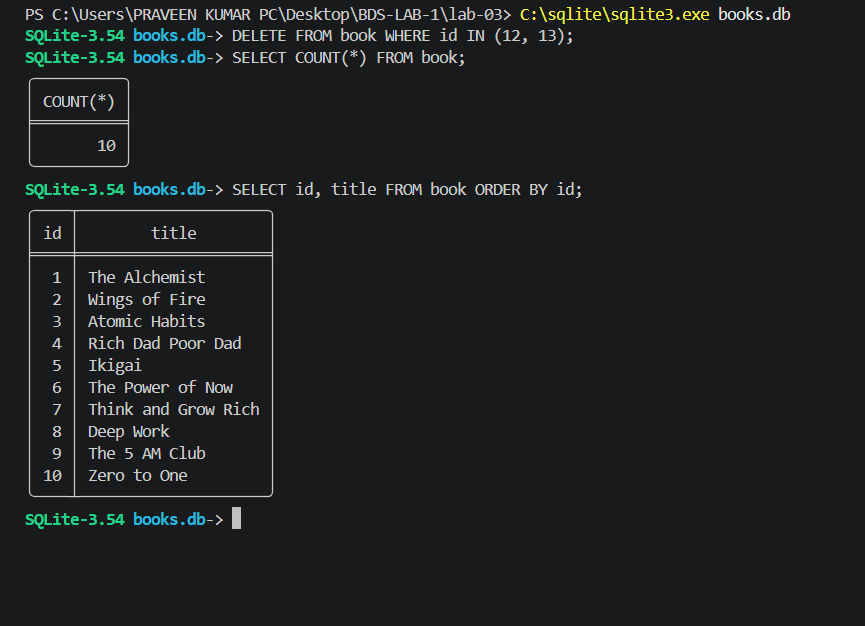

## How to Run the Project

1. Open the project folder in VS Code.
2. Install dependencies:

```bash
npm install
```

3. Start the development server:

```bash
npm run dev
```

4. Open the API in your browser or Postman:

`http://localhost:3000/books`

## Conclusion

Successfully developed and tested an advanced REST API using Node.js, Express.js, and SQLite. Implemented CRUD operations, searching, sorting, pagination, price filtering, and request validation. Verified API responses using Postman and confirmed the database records using SQLite.